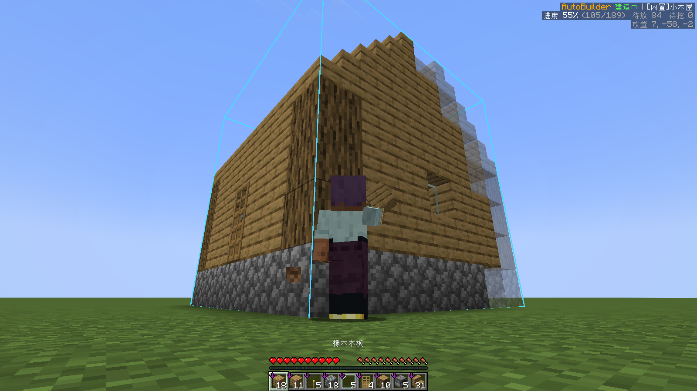
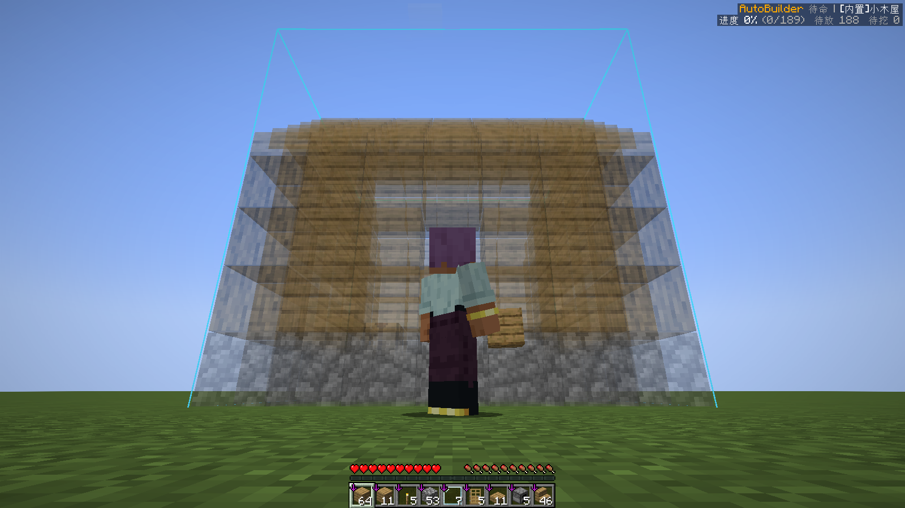
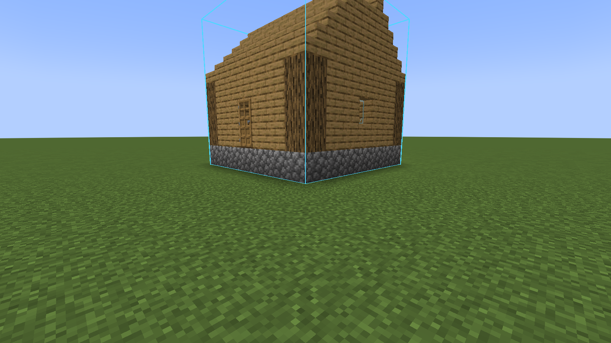

# AutoBuilder

A client-side NeoForge mod for Minecraft 1.21.1 that makes **your own player** build a structure from a schematic in survival mode. It walks there, places blocks, fixes mistakes, builds and removes its own scaffolding, and fetches materials from chests. The server does not need to install anything.

[简体中文说明见下方](#简体中文)



| Translucent preview | Finished |
| --- | --- |
|  |  |

## Features

- **Schematic formats**: Litematica `.litematic`, Sponge `.schem` (v2/v3), vanilla structure `.nbt`, plus three built-in presets (cabin, watchtower, fenced yard).
- **Fully automatic building**: A* pathfinding (walk, jump, fall, pillar up, bridge, dig through terrain), bottom-up layer order, correct facing for stairs, logs, doors, ladders, torches, etc.
- **Fixes the world**: breaks wrongly placed blocks and blocks where the schematic has air; flips levers/repeaters/comparators/note blocks to the right state.
- **Redstone machines and fluids**: places water/lava sources with buckets in a safe order (fluids only after their layer is enclosed), waterlogs blocks, places observers only after the block they watch is final, refills water buckets from infinite sources.
- **Scaffolding**: pillars and bridges with cheap blocks (dirt, cobblestone…) and removes them top-down when finished. Avoids sealing itself inside the building.
- **Supply chests**: register chests / barrels / shulker boxes; when materials run out it walks over, deposits junk and takes what it needs.
- **Resume**: progress is saved per world and dimension; after disconnecting or restarting, press N to continue.
- **Save buildings**: select two corners and save any build as a `.nbt` schematic.
- **Safety**: auto-eats, stops on low health, escapes lava, pauses as soon as you press a movement key.
- **Preview**: translucent ghost blocks and outlines for blocks to break.

## Usage

1. Put schematic files in `.minecraft/autobuild/` (with version isolation: `versions/<version>/autobuild/`).
2. Press **B** to open the main screen, pick a schematic and click *Load in front of me*. Rotate / mirror / move it until the preview is where you want it.
3. Put the materials in your inventory (or register supply chests) and press **N** to start. Press N again or any movement key to pause.

Type `/ab help` in chat for the full command list (hover over a command for details, click to fill it in).

| Key | Action |
| --- | --- |
| B | Open main screen |
| N | Start / pause |
| `[` / `]` | Selection corner 1 / 2 (block under crosshair) |

Settings: *Settings…* button on the main screen, `/ab config`, or Mods → AutoBuilder → Config.

## Multiplayer and server opt-out

AutoBuilder uses the normal block interaction packets a player sends. By default it places blocks directly at the target position ("air place"); servers with anti-cheat may reject this, so switch **Place mode** to *Click adjacent face* in the settings. **Only use it on servers whose rules allow automation.**

Server owners can disable automatic building for all AutoBuilder users on their server. Either:

- put `[NoAutoBuilder]` anywhere in the server MOTD, or
- send players a system message containing `[NoAutoBuilder]` (e.g. in a join message or with `tellraw`). A message consisting only of the marker is hidden from chat.

When disabled, AutoBuilder will not move or place anything; previewing and saving schematics still work. Singleplayer is never affected.

## Requirements

- Minecraft 1.21.1
- NeoForge 21.1.x
- Client only (works on vanilla, Paper and modded servers)

## Building from source

```
./gradlew build
```

The jar is written to `build/libs/`.

## License

MIT

---

## 简体中文

Minecraft 1.21.1 NeoForge **纯客户端** mod：在生存模式下让玩家自己按蓝图自动盖房子。它会自动寻路、放方块、挖掉放错的方块、搭脚手架并在完工后拆掉、去材料箱取料。服务器不需要安装。

### 功能

- **蓝图格式**：`.litematic`、`.schem`（v2/v3）、原版结构 `.nbt`，另带 3 个内置建筑（小木屋、瞭望塔、围栏小院）。
- **全自动建造**：A* 寻路（走、跳、下落、垫柱子、搭桥、挖开挡路的地形），从下往上一层层建，楼梯、原木、门、梯子、火把等方块朝向正确。
- **修正世界**：挖掉放错的方块和蓝图里应为空气的方块；拉杆、中继器、比较器、音符盒自动调到蓝图的状态。
- **红石机器与液体**：用桶放水源和岩浆源，等液体所在层围好后再倒；含水方块；侦测器等它盯着的方块就位再放；水桶空了自动去无限水打水。
- **脚手架**：用泥土、圆石等便宜方块垫柱子、搭桥，完工后从上往下拆掉；不会把自己封在建筑里。
- **材料箱**：登记箱子、木桶或潜影盒，缺料时自动走过去存杂物、取材料。
- **断点续建**：进度按世界和维度保存，掉线或重启后按 N 接着建。
- **保存建筑**：选两个角就能把任何建筑存成 `.nbt` 蓝图。
- **安全**：自动吃东西、低血量停止、掉进岩浆自救、一按移动键就暂停。
- **预览**：半透明的待放方块，待挖方块有描边。

### 用法

1. 把蓝图放进 `.minecraft/autobuild/`（开了版本隔离就放在 `versions/<版本>/autobuild/`）。
2. 按 **B** 打开主界面，选蓝图，点「加载到面前」，用旋转、镜像、移动把预览摆到想要的位置。
3. 材料放进背包（或登记材料箱），按 **N** 开始。再按 N 或按任意移动键暂停。

聊天栏输入 `/ab help` 查看全部指令（鼠标悬停看说明，点击填进聊天栏）。设置：主界面右上角「设置…」、`/ab config`，或 模组 → AutoBuilder → 配置。

### 多人游戏与服务器禁用

AutoBuilder 发送的是玩家正常的放置、挖掘数据包。默认「直接放」模式不需要依附面，装了反作弊的服务器可能会拒绝，这时在设置里把「放置方式」改成「点相邻方块的面」。**请只在规则允许自动化的服务器上使用。**

服务器管理员可以禁止本服玩家使用自动建造，任选一种：

- 在服务器 MOTD 里任意位置加上 `[NoAutoBuilder]`；
- 给玩家发一条含 `[NoAutoBuilder]` 的系统消息（如进服欢迎语或 `tellraw`）。只有这个标记的消息不会显示出来。

禁用后 AutoBuilder 不会移动或放置任何东西，预览和保存蓝图照常可用。单人游戏不受影响。
